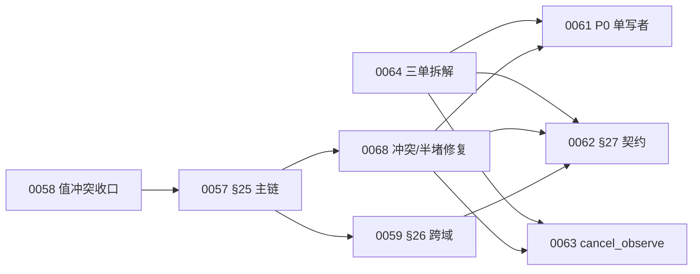

# Next 基础能力骨架整合方案（wo-ultimaagent-20261113-0069）

> 版本：v1.0｜日期：2026-11-14｜角色：方案设计者｜范围：六块＋Console＋治理⑤，不新增模块、不新增八态、不新增第二写者。
>
> T1 前置核验命令：`$p='docs/reports/fix-wo-ultimaagent-20261113-0068.md'; Test-Path -LiteralPath $p -PathType Leaf; Get-Content -LiteralPath $p -Tail 40 | Select-String '^T6_GATE=PASS$'`
>
> T1 实测输出：`gate_exists=True`；`tail_gate_hits=1`；命中行=`T6_GATE=PASS`。前置通过，允许继续 T2。
## §1 结论摘要

**推荐采用“Core 定意图与计划、Console 定运行次序、Middleware 写队列与票据、Shell 独占进程、Surface 只画、Memory 只写 memory schema、Voice 管语音、治理⑤只下约束”的单向骨架。三处最易打架点是 Core/Console 排序、Console/Middleware 队列写口、补偿终态；分别由 §3 W-04、W-01、W-08 的单写者门防住。第一刀切 0061：审卡通过后以零内容前置落唯一 writer、幂等 inbox 与只读对账。**

### 本方案相对既有文档的净增量（9 条）

1. **N-01 八项职责矩阵**：把六块＋Console＋治理⑤的“写什么／绝不写什么”落成机检边界；收口架构页 §02、基线 §19.2～§19.4、§20.4 的散落描述。
2. **N-02 十一事实单写者表**：为队列、run、会话、计划、上下文、记忆、卡账、补偿、进程、用量、灰度逐项指定唯一写者；收口基线 §14.3、§21.4、§22.2、§25.1～§25.11 与 0068 §3。
3. **N-03 主文地图**：统一 §25.1～§25.11、§26、§27 与本方案新增 glue 契约的引用纪律；收口 0066 §5.2 的“各写一半”风险。
4. **N-04 八边交互矩阵**：每边补齐请求、回执、失败落点、超时重试、幂等五项；复用基线字段，不另立第二套同义 ABI。
5. **N-05 集成错误码前缀**：冻结 `NXI_<EDGE>_<CAUSE>` 仅用于主文尚无错误码的胶合失败，并给重号扫描；不覆盖 `MEM_*`、`CONTEXT_*`、`DOR_FAIL` 等现有码。
6. **N-06 八卡无环依赖图**：给出每节点恰一次的拓扑序列与止损线；收口 0057/0058/0059、0061/0062/0063/0064/0068 卡头的分散前置。
7. **N-07 最小可开工切片**：推荐 0061；内容依赖为零，流程前置仅“卡审通过”，通过证据为 writer selftest、三夹具对账与写口扫描。
8. **N-08 八卡去重表**：明确每卡保留、收窄或被 0068 修复吸收的范围，防止把历史评审问题复制成新设计。
9. **N-09 三项待拍默认**：只保留发布批次、错误码登记载体、0063 启动时点三项非阻塞选择；每项均给推荐与可反向默认。

## §2 职责与边界总表

下表中的 `src/next/*` 是后续实现卡的**目标路径约定**，不表示新增运行时模块；目录仍只映射六块，Console 与 `queue_engine` 同进程，治理⑤无独立进程。所有逻辑写入经已登记端口完成；“拥有事实”不等于“可以绕过 storage/writer 直接写磁盘”。

| 块 | 职责一句话 | 写入什么 | 绝对不写什么 | 边界判据（后续实现 Gate） |
|---|---|---|---|---|
| **Core** | 把回合事实裁成决定、上下文与不可变计划，并发出记忆写入授权。 | `session_id` 创建记录、`context.compose` 结果、`decision`、`plan.schema`、`memory.write` 授权；目标子件 `session_manager/context_composer/planner/memory_boundary`。 | 不写队列状态、run/receipt、任务卡账、记忆库字节、OS 进程、像素。 | 查 `src/next/core/*.py`；命令 `rg -n -e 'queue-status\.json' -e 'subprocess\.' -e 'CreateProcess' -e 'Process\.Start' -e 'renderer' -e 'task_store\.insert' -e 'task_store\.update' src/next/core`；期望 0 命中。 |
| **Senses.Voice** | 负责唤醒、采集、ASR、播报及语音侧回执，原样透传会话标识。 | `turn_id`、原始 ASR/置信信息、`speak.receipt`、音频设备事实；目标子件 `turn_loop/speak`。 | 不生成/改写 `session_id`，不裁定 intent，不写 plan、Memory、队列或卡账。 | 查 `src/next/senses_voice/*.py`；命令 `rg -n -e 'session_id\s*=' -e 'plan_id\s*=' -e 'queue-status\.json' -e 'mem\.write' -e 'ask\.key' src/next/senses_voice`；期望 0 命中。 |
| **Shell** | 唯一执行起、停、查进程与 PTY/Job 托管，返回可验证的进程事实。 | OS 进程树、Job/PTY 句柄、`host.fact`、终止凭据；目标子件 `child_supervisor/host_control/pty_host`。 | 不判八态、不排优先级、不写 plan、queue、receipt 或 UI。 | 查 `src/next/shell/*.py`；命令 `rg -n -e 'QueueState' -e 'queue-status\.json' -e 'plan_id\s*=' -e 'render' -e 'receipt\.json' src/next/shell`；期望 0 命中；反向扫描进程 API 只允许 Shell，见 W-09。 |
| **Surface** | 只把 Console 给定的 view model 画像素并回 render receipt。 | 本地渲染帧、锚位状态、`render.receipt`；目标子件 `projection/renderer`。 | 不写任务/卡片/八态，不调执行器，不起进程，不改显示内容的业务含义。 | 查 `src/next/surface/*.py`；命令 `rg -n -e 'queue-status\.json' -e 'task_store\.insert' -e 'task_store\.update' -e 'dispatch\.' -e 'subprocess\.' -e 'CreateProcess' src/next/surface`；期望 0 命中。 |
| **Memory** | 在 Core 授权后写 `memory` schema，并按 `mem/kb/exp` 分入口检索。 | 记忆记录、版本、索引、检查点及 `mem.commit_ack`；目标子件 `writer/store_backend`。 | 不写 `task`/`log` schema，不裁定是否应记，不写规则、queue、plan。 | 查 `src/next/memory/*.py`；命令 `rg -n -e 'schema\s*=\s*["'"']task["'"']' -e 'schema\s*=\s*["'"']log["'"']' -e 'queue-status\.json' -e 'policy\.publish' -e 'plan_id\s*=' src/next/memory`；期望 0 命中。 |
| **Middleware** | 守八态与派发事务、run/receipt、幂等和补偿，所有 OS 动作委托 Shell。 | `queue.state`、run、普通/补偿 receipt、operation 账、dispatch 事务；现有落点 `tasks/queue_engine/*`；目标落点（待建，由 0061 建立）`scripts/queue-writer.py`。 | 不直接起 OS 进程、不画像素、不决定计划优先级、不创建用户会话。 | 查 `tasks/queue_engine/*.py` 与 `src/next/middleware/*.py`；命令 `rg -n -e 'subprocess\.Popen' -e 'CreateProcess' -e 'Process\.Start' -e 'CreatePseudoConsole' src/next/middleware`；期望 0 命中，进程动作只能调用 `Shell.host_control`。 |
| **Console** | 消费计划和事实，唯一决定运行期可执行顺序/优先级，并管理卡账、用量账与呈现时机。 | 编排决策、`ask.key` 卡账事务、`usage_ledger` 行、Surface view model；持久化只经 queue_engine 端口。 | 不写 `queue-status.json`，不碰进程、客户端 socket、磁盘、像素，不改 plan 依赖声明。 | 查 `src/next/console/*.py`；命令 `rg -n -e 'queue-status\.json' -e 'open\(' -e 'write_text' -e 'socket\.' -e 'subprocess\.' -e 'CreateProcess' -e 'draw' -e 'render_frame' src/next/console`；期望 0 命中。 |
| **治理⑤** | 版本化发布软约束/策略/红线并作 fail-closed 检查与审计，不承载业务动作。 | `policy_version`、灰度规则、append-only 审计事件；目标落点（待建，由后续治理单建立）`config/governance/*` 与 `tasks/queue_engine/policy_gate.py`，无独立进程。 | 不写计划、任务状态、Memory、进程、UI；不直接 dispatch、install、egress 或 user-data-write。 | 查 `config/governance/*`、`tasks/queue_engine/policy_gate.py`；命令 `rg -n -e 'dispatch\.' -e 'host\.control' -e 'mem\.write' -e 'queue-status\.json' -e 'render' tasks/queue_engine/policy_gate.py`；除返回 `allow/deny` 的字段名外期望 0 业务调用。 |

### §2.1 四条边界裁决

1. **计划与顺序**：Core 写 `steps[]/depends_on` 的约束事实；Console 只能在这些约束内选 READY 步骤与优先级，不能改写依赖图。
2. **逻辑权与物理写**：Console 对卡账/用量账拥有逻辑事务权，但落盘只能调用 queue_engine storage port；这不是两个写者，后者只是字节落盘适配器，禁止产生独立业务判断。
3. **run 与进程**：Middleware 的 `start` 只建立 run 并委托 `Shell.host_control(start)`；Shell 返回 `host.fact` 后才可把 pid 写进 run。Middleware 直接 `Popen/CreateProcess` 即越界。
4. **治理与业务**：治理⑤只返回带版本的 `allow/deny` 和记审计；被约束模块仍负责自己的业务动作，治理⑤不得代执行。

## §3 唯一写权清单

### §3.1 机检约定

后续实现中的每个业务写者必须在唯一实现文件声明 `WRITE_AUTHORITY = '<fact>'`；同一 fact 命中数必须为 1。该标记证明逻辑写权，表内的第二条 sink 扫描再证明没有旁路。测试夹具与 archive/research 排除在扫描外；生产代码不得用动态字符串规避扫描。

| ID / 事实 | 唯一写者（建议函数） | 读者 | 禁止旁路（最容易犯者） | 机检语句：文件／字段／命令／oracle |
|---|---|---|---|---|
| **W-01 队列状态 `state`** | `scripts/queue-writer.py::apply_transition`；`tasks/queue_engine/state_machine.py` 只判迁移语义，不落盘。 | Console、Manager、Surface、审计、reconcile。 | `dispatch-work-order.py`、Console.orchestrator、reconcile 最易直接改 `queue-status.json`；一律禁止。 | 查 `tasks/queue/queue-status.json.state`；fact=`queue.state`；`rg -n 'WRITE_AUTHORITY\s*=\s*["'"']queue\.state["'"']' scripts tasks/queue_engine src/next` 必须仅命中 `scripts/queue-writer.py` 1 次；`rg -n -e 'write_text.*queue-status\.json' -e 'write_bytes.*queue-status\.json' -e 'os\.replace.*queue-status\.json' -e 'open\(.*[wa].*queue-status\.json' scripts tasks/queue_engine src/next` 也只能命中该文件。 |
| **W-02 run 票据** | `tasks/queue_engine/receipt_contract.py::finalize` 写 `run/<run_id>/receipt.json`，一次固化。 | Console、审计、usage ledger、补偿器。 | `run_worker.py`、executor adapter、Shell 最易自行宣布完成或覆盖 receipt。 | 查 `tasks/queue_engine/run/<run_id>/receipt.json` 的 `run_id/exit/artifacts/side_effects/usage/idempotency_key`；authority 扫描 fact=`run.receipt` 必须仅命中 `receipt_contract.py`；`rg -n -e 'write_text.*receipt\.json' -e 'open\(.*receipt\.json' tasks/queue_engine scripts src/next` 只允许该文件。 |
| **W-03 `session_id`** | `src/next/core/session_manager.py::create_session`；Core 创建，Voice/事件层只透传。 | Voice、context composer、Memory、Middleware、日志。 | `Senses.Voice.turn_loop`、0062 事件入口、claim adapter 最易从 `claim_id` 派生或静默换值。 | 查 `turn.envelope.session_id`；fact=`session.id` 只能命中 `core/session_manager.py`；`rg -n -e 'session_id\s*=' -e '["'"']session_id["'"']\s*:' src/next --glob '!**/tests/**'` 中的“生成/uuid”调用只能出现在该文件，其他命中必须是原样复制。 |
| **W-04 `plan.schema`** | `src/next/core/planner.py::build_plan` 生成不可变 `plan_id/steps[]/depends_on`。 | Console、Middleware、审计、Surface 只读。 | `Console.orchestrator` 最易重排并回写 `depends_on`；Middleware 最易补参数后覆盖 plan。 | 查 `plan.schema.plan_id/steps[].depends_on`；fact=`plan.schema` 只能命中 `core/planner.py`；`rg -n -e 'depends_on.*=' -e 'steps.*=' src/next/console src/next/middleware --glob '!**/tests/**'` 期望 0 个写赋值命中。 |
| **W-05 上下文装配结果** | `src/next/core/context_composer.py::compose` 写 `payload/included_partitions/trimmed_partitions/input_tokens/budget_ref/error_code`。 | 主脑入口、审计。 | provider adapter、Skill、Voice 最易自行拼 prompt 或二次裁剪。 | 查 §25.3 返回字段；fact=`context.compose.result` 只能命中 `core/context_composer.py`；`rg -n -e 'build_prompt' -e 'compose_context' -e 'payload\s*=' src/next --glob '!**/core/context_composer.py' --glob '!**/tests/**'` 期望 0 命中。 |
| **W-06 记忆记录与版本** | `src/next/memory/writer.py::commit` 是 `memory` schema 的唯一物理写者；Core.memory_boundary 是唯一授权者但不落库。 | Core、Memory 检索、审计。 | Core、Console、habit adapter 最易直接写 DB；store backend 最易绕过授权暴露通用 update。 | 查 `memory` schema 的 `memory_id/write_version`；fact=`memory.record` 只能命中 `memory/writer.py`；`rg -n -e 'store_backend\.insert' -e 'store_backend\.update' -e 'store_backend\.delete' -e 'sqlite.*INSERT' -e 'sqlite.*UPDATE' -e 'sqlite.*DELETE' src/next --glob '!**/memory/writer.py' --glob '!**/tests/**'` 期望 0 命中。 |
| **W-07 任务卡账 `ask.key`** | `src/next/console/task_store.py::upsert_ask`；物理落盘调用 queue_engine storage port，不另作业务判断。 | Core.clarify、Surface、审计。 | Core 最易持“未关闭”集合；Surface 最易点击后直接 close；两者都会造第二卡账。 | 查 task schema 的 `ask.key/closed_at/resolve`；fact=`task.ask_ledger` 只能命中 `console/task_store.py`；`rg -n -e 'ask_key.*insert' -e 'ask_key.*update' -e 'ask_key.*close' -e 'ask_key.*resolve' -e 'ask\.key.*insert' -e 'ask\.key.*update' -e 'ask\.key.*close' -e 'ask\.key.*resolve' src/next/core src/next/surface` 期望 0 命中。 |
| **W-08 补偿 receipt** | `tasks/queue_engine/receipt_contract.py::write_compensation_receipt`，键为 `compensation_key`。 | finalize、Console、审计、human/brain。 | compensator plugin、Console、治理⑤最易在失败后各写一份结论。 | 查补偿 receipt 的 `compensation_key/original_run_id/compensator_id/result/evidence_ref/occurred_at`；fact=`compensation.receipt` 必须仅命中 `receipt_contract.py`；`rg -n -e 'compensation_receipt.*write' -e 'compensation_receipt.*open' -e 'compensation_receipt.*replace' -e 'compensate_failed.*write' -e 'compensate_failed.*open' -e 'compensate_failed.*replace' tasks/queue_engine src/next scripts` 只允许该文件。 |
| **W-09 进程树** | `src/next/shell/child_supervisor.py::spawn/terminate_tree`；`pty_host.py` 仅经 supervisor 登记。 | Middleware、Console Manager、Surface 只读。 | Middleware.executor.start、Console、Lifecycle 最易直接起进程；会制造第二父进程。 | 查 `host.fact.instance_token/created_at/active_processes`；fact=`process.tree` 只能命中 `shell/child_supervisor.py`；`rg -n -e 'subprocess\.Popen' -e 'CreateProcess' -e 'Process\.Start' -e 'Win32_Process\.Create' -e 'CreatePseudoConsole' src/next --glob '!**/tests/**'` 的每个命中路径必须位于 `src/next/shell/`。 |
| **W-10 用量账本** | `src/next/console/usage_ledger.py::record_receipt_usage` 以 receipt 为唯一输入，经 storage port 追加。 | Console 视图、治理配额检查、审计。 | provider adapter 最易报一份自计费；Middleware 最易同时累加，产生双账。 | 查 `usage_ledger(provider,capability,task_id,input_tokens,output_tokens,duration,calls,receipt_ref)`；fact=`usage.ledger` 只能命中 `console/usage_ledger.py`；`rg -n -e 'usage_ledger.*insert' -e 'usage_ledger.*append' -e 'usage_ledger.*update' -e 'input_tokens.*insert' -e 'input_tokens.*append' -e 'input_tokens.*update' -e 'output_tokens.*insert' -e 'output_tokens.*append' -e 'output_tokens.*update' src/next/middleware src/next/providers` 期望 0 命中。 |
| **W-11 灰度规则** | `tasks/queue_engine/policy_gate.py::publish_canary_rule` 写 `config/governance/canary-rules.json` 的版本化规则；运行期只读。 | Console、Update/Lifecycle、审计。 | Update、provider、Console 最易在本地硬编码阈值或自行推进档位。 | 查 `canary-rules.json.rules[].version/stage/slo_ref/action`；fact=`governance.canary_rule` 只能命中 `policy_gate.py`；`rg -n -e '5\s*→\s*25\s*→\s*50\s*→\s*100' -e 'canary.*threshold\s*=' -e 'canary.*stage\s*=' src/next tasks/queue_engine --glob '!**/policy_gate.py' --glob '!**/tests/**'` 期望 0 硬编码命中。 |

### §3.2 三个冲突的唯一收口

- **S-001**：W-04 冻结 Core 写计划约束，Console 只作运行期选择；任何 Console 回写 `depends_on` 直接 FAIL。
- **S-002**：W-01 冻结 `state_machine=唯一语义源`、`queue-writer=唯一落盘写者`、`Console=只读投影＋迁移意图提交者`；不得再出现“Console 读写八态”。
- **S-003**：W-08 的补偿失败 receipt 先驱动唯一 writer 落 `FAILED`；仅当 `retryCount ≥ 2` 时由 W-01 按现有合法迁移落 `BLOCKED`，绝无直达分支。

## §4 主文地图

### §4.1 唯一主文与引用纪律

| ID / 契约名 | 唯一主文位置 | 允许的引用形式 | 已知违规点与唯一收口 |
|---|---|---|---|
| **M-25.1 回合/播报信封** | 基线 §25.1 | 只写“字段、方向、outcome 见 §25.1”，不得复制字段表。 | 无现存冲突；`session_id` 的创建语义不得在 §27.4 重述（0062 已改为指针式）。 |
| **M-25.2 记忆读写确认** | 基线 §25.2 | 只引用 `mem.read/write/commit_ack` 与 `MEM_*`；容量只再指 §17.2.3。 | 无现存冲突；Memory 物理写与 Core 授权按 W-06 分层。 |
| **M-25.3 上下文装配** | 基线 §25.3 | 只引用 `context.compose`、七区、§16.4 预算；不得自拼 payload。 | **G-03 已由 0068 F-3 修复**：请求/返回表和三失败码齐；第二 composer 计数必须 0。 |
| **M-25.4 决策三态** | 基线 §25.4 | 只引用 `clarify/proceed/refuse` 与优先级；不得引第四值。 | 0057 卡旧写项出现过 `execute`，现行基线已唯一收口为 `proceed`。 |
| **M-25.5 计划 schema/步骤态** | 基线 §25.5 | Core 产 `steps/depends_on`；其他文档只指针引用。 | **S-001 已由 0068 F-6 修复**：Core 不再“控制执行顺序”，Console 只消费约束并排运行序。 |
| **M-25.6 计划交接** | 基线 §25.6 | 只引用 submit 请求、受理回执、三拒绝码；`queue_state` 是 writer 结果回带。 | 不得把 Console 受理误写成 Console 直写队列；W-01 为唯一落盘。 |
| **M-25.7 派发 ABI/时序** | 基线 §25.7 | 只引用 `prepare→policy.check→start→stream*→finalize` 和三段报文；§26.7 只补 policy API 本体。 | 0056-C-07 的 API 本体仍归 0059 §26.7；调用时点不得在 §26 改写。 |
| **M-25.8 执行器 SPI** | 基线 §25.8 | 只引用五动词签名；OS 进程动作指向 §26.3/Shell。 | 0056-C-04 由 0059 §26.3 补 host ABI；`start` 只建 run，不得直接起 OS 进程。 |
| **M-25.9 幂等/receipt 账本** | 基线 §25.9 | 只引用 operation 公式；保留期只指 §22.2，不复述年限。 | **G-05 已由 0068 F-5 修复**：`TBD-G05-RETENTION` 清零，无第二保留期数值。 |
| **M-25.10 取消** | 基线 §25.10 | 只引用 plan→step→run、3s、终止凭据；0063 只能在本节内追加 run 观测块。 | 0063 尚未获冻结前置时不得写；`CANCELLED_PENDING` 只能是投影标记，绝非第九态。 |
| **M-25.11 补偿** | 基线 §25.11 | 只引用三类副作用、compensator/receipt 与失败迁移；不得另立补偿结果。 | **C-17 与 S-003 已由 0068 F-2/F-4 修复**：补偿失败先 `FAILED`，`retryCount≥2` 后才 `BLOCKED`。 |
| **M-26 跨域 API 预留** | 0059 冻结后为基线 §26.1～§26.16；冻结前唯一设计源为 0059 卡。 | 当前只可写“预留，字段以 0059 冻结稿为准”；不得称正文已存在。 | 0057 审计所报 §26.7/§26.11 无锚点尚未由现行基线闭合；0059 不得缩成 6 条。 |
| **M-27 事件/熔断/卡幂等预留** | 0062 冻结后为基线 §27.1～§27.4；冻结前唯一设计源为 0062 卡。 | 当前只引用卡号与拟落节；不得把卡面字段冒充生效基线。 | `cancel_observe` 明确不在 §27，归 0063→§25.10；M2/M5/M6/M8/M9 不进入本批。 |
| **M-QW 队列单写口** | 基线 §14.3（语义/写口总则）；§19.3 只保留 Console 边界指针。 | 引用固定句：`state_machine` 唯一定义语义，`queue-writer` 唯一落盘，Console 只读。 | **S-002 已由 0068 F-1 修复**；0061 只实现该契约，不拥有第二主文。 |
| **M-HOST host.control/host.fact** | 0059 冻结后的基线 §26.3；不改变 §15.5 的 Shell 单父不变式。 | ABI 字段只在 §26.3 定义；其他节只说“委托 Shell 并收事实”。 | 0056-C-04 当前为预留缺口；未落 §26.3 前 Middleware 不得自拟临时 spawn ABI。 |
| **M-PROJ 执行态呈现投影** | 本方案 §5 E-06/E-07；实施后吸收到 N-13 Console 卡的契约测试，基线只留指针。 | Middleware 只发事实投影给 Console；Console 再发 render model 给 Surface；禁止直连。 | 解决 0066 #9 中“经 Console 中介”的隐含关系，避免 Middleware→Surface 另长直写 ABI。 |
| **M-GOV 治理施加** | 0059 冻结后的基线 §26.7；治理分类仍只认基线 §20.4。 | 各块只调用 `policy.check` 并引用 policy version；不得复制四类治理定义。 | 0056-C-07 当前为预留缺口；§25.7 保留唯一调用时点，§26.7 只定义 API。 |

覆盖复算：§25.1～§25.11 共 11/11；§26、§27 预留位 2/2；本项目新增 glue 契约 M-QW/M-HOST/M-PROJ/M-GOV 4/4；遗漏 0。

### §4.2 错误码登记与重号核对

1. 既有错误码原名复用：`MEM_*`、`CONTEXT_*`、`DOR_FAIL/DUP_PLAN/BUDGET_EXCEED`、0059 拟定的 host 码，均不得换同义名。
2. 本方案只为“现有主文没有定义的集成胶合失败”登记前缀 **`NXI_<EDGE>_<CAUSE>`**；`NXI` 不代表新状态，只是失败原因。
3. 错误码**定义行**只允许表格形态 ``| `CODE` |``。重号核对命令（扫描现行基线、本方案、0059/0062 卡；历史报告只作证据，不参与现行定义）：

```powershell
$files=@('docs/specs/next-感知交互参数基线-20261113.md','docs/plans/next-基础能力骨架整合方案-20261114.md','tasks/queue/wo-ultimaagent-20261113-0059--next-fix-c-cross-domain.md','tasks/queue/wo-ultimaagent-20261113-0062--autoloop-p1-contracts.md')
$defs=rg -o --no-filename '^\| `(NXI_|MEM_|CONTEXT_|DOR_|DUP_|BUDGET_|NO_|ALREADY_|DRAIN_|LOG_)[A-Z0-9_]+` \|' $files | ForEach-Object { ($_ -split '`')[1] }
$defs | Group-Object | Where-Object Count -gt 1
```

oracle：输出必须为空；若非空，新增 `NXI_*` 让位于已有定义并改名，既有码不动。

### §4.3 `NXI` 胶合错误码登记表（唯一定义）

| 错误码 | 所属边 | 唯一含义／失败落点 |
|---|---|---|
| `NXI_VC_INVALID_ENVELOPE` | E-01 | Voice envelope 字段/类型不合法；Core 拒收并留事件。 |
| `NXI_VC_DEADLINE_EXPIRED` | E-01 | Core 收到时绝对 deadline 已过；不建计划。 |
| `NXI_CC_SUBMIT_TIMEOUT` | E-03 | Core 未取得 Console 受理事实；保持未派发。 |
| `NXI_CMW_POLICY_DENIED` | E-04 | dispatch 在 start 前被治理门拒绝；保持 QUEUED。 |
| `NXI_CMW_DEADLINE_EXPIRED` | E-04 | dispatch deadline 到期；未 start 不动状态，已 start 固化失败/取消 receipt。 |
| `NXI_CMW_EXECUTOR_UNAVAILABLE` | E-04 | 执行器不可用；由 writer 合法落 FAILED。 |
| `NXI_MSH_SPAWN_FAILED` | E-05 | Shell 未建立受托进程且有失败证据；回 host.fact。 |
| `NXI_MSF_DIRECT_WRITE_FORBIDDEN` | E-06 | Middleware 试图绕 Console 直写 Surface；边界拒绝。 |
| `NXI_MSF_STALE_SEQUENCE` | E-06 | Console 收到旧 execution projection；丢弃旧序列。 |
| `NXI_CSF_RENDER_REJECTED` | E-07 | Surface 拒绝渲染请求；Console 保持上一帧。 |
| `NXI_CSF_STALE_SEQUENCE` | E-07 | Surface 收到旧 render sequence；回拒且不反向改内容。 |
| `NXI_GOV_UNKNOWN_ACTION` | E-08 | action 未登记；fail-closed。 |
| `NXI_GOV_CONTEXT_INVALID` | E-08 | ctx 不满足 policy schema；fail-closed。 |
| `NXI_GOV_VERSION_UNAVAILABLE` | E-08 | 生效策略版本不可读取；fail-closed。 |
| `NXI_GOV_DENIED` | E-08 | 规则命中拒绝；回 policy/audit 引用。 |

## §5 跨模块交互契约

字段记法：`R=必填`、`O=可选`；字段名与 §25/0059/0062 已定义者逐字复用。所有新码的唯一登记处就是本节对应行。

| ID / 交互 | 请求字段（名:类型:必填） | 返回／回执字段 | 失败码与失败落点 | 超时与重试归属 | 幂等要求 |
|---|---|---|---|---|---|
| **E-01 Voice→Core** | `turn.envelope`：`turn_id:string:R`、`session_id:string:R`、`speaker:string:R`、`asr_conf:object:R`、`intent:object\|null:R`（入 Core 可空）、`deadline:timestamp:R`、`cancel_token:string:R`、`trace_id:string:R`。 | 成功返回 §25.4 decision 对象：共同字段 `decision:string:R, turn_id:string:R`，其余按 `clarify/proceed/refuse` 各自必填；播报另走 §25.1 `speak.request/receipt`，不混入本回执。 | `NXI_VC_INVALID_ENVELOPE`：Core 拒收并记 `log.append`，不建 plan；`NXI_VC_DEADLINE_EXPIRED`：Core 留超时事件，返回 `refuse`/明确 reason，不推进主链。 | Core 校验绝对 `deadline`；自动重试 **0 次**。Voice 若重新识别，必须开新 `turn_id`；同一 envelope 的网络重放只走幂等回读。 | 键=`session_id\|turn_id`；同键同摘要返回原 decision，不重复触发记忆或计划；同键异摘要 fail-closed。 |
| **E-02 Core→Memory** | `mem.read(turn_id:string:R,session_id:string:R,query:string:R,deadline:timestamp:R)`；`mem.write(turn_id:string:R,memory_id:string:R,payload:object:R,deadline:timestamp:R)`；`mem.commit_ack(turn_id:string:R,memory_id:string:R,write_version:string:R,rollback_marker:string:R,deadline:timestamp:R)`。 | read=`items:object[]:R,degraded:boolean:R`；write=`write_version:string:R`；ack=`committed:boolean:R,rollback_marker:string:R`。 | 只用 `MEM_TIMEOUT/MEM_WRITE_CONFLICT/MEM_FULL`；落点是 Memory 回执＋审计，写/确认失败保持未提交，绝不由 Memory 改队列。 | Core 拥有 deadline 与重试决策；read 到期不重试、空结果降级；write/ack 仅按 §21.6 既有门重试，Memory 不自循环。 | read 键=`turn_id\|query_hash`；write/ack 键=`turn_id\|memory_id`；重放返回同一 `write_version/rollback_marker`。 |
| **E-03 Core→Console** | `console.submit_plan`：`plan:object:R`、`idempotency_key:string:R`、`submitted_by:string:R`；plan 内字段只认 §25.5。 | `submission_id:string:R`、`plan_id:string:R`、`queue_state:enum:R`（首次仅 `QUEUED`）、`accepted_at:timestamp:R`；拒绝按 §25.6 回写结构。 | 只用 `DOR_FAIL/DUP_PLAN/BUDGET_EXCEED`；`NXI_CC_SUBMIT_TIMEOUT` 仅表示未取得受理事实，落 Core 事件并保持未派发，禁止猜成 QUEUED。 | Core 拥有提交超时；仅当回写 `retryable=true` 或超时后查不到同键 submission 时重放，Console 不回调重试。 | 键固定=`plan_id\|owner_turn`；同键同摘要回原 `submission_id`，异摘要=`DUP_PLAN`。 |
| **E-04 Console→Middleware** | §25.7 `dispatch.request`：`plan_id:string:R`、`step_id:string:R`、`tool_id:string:R`、`args:object:R`、`idempotency_key:string:R`、`deadline:timestamp:R`、`sandbox_profile:string:R`。 | 先回 `dispatch.run(run_id:string:R,pid:integer\|null:R,stdout_ref:string:R,stderr_ref:string:R)`；最终 `dispatch.receipt(exit:object:R,artifacts:object[]:R,side_effects:object[]:R,usage:object:R,idempotency_key:string:R)`。 | `NXI_CMW_POLICY_DENIED`：`start` 前保持 QUEUED 并留 policy_ref；`NXI_CMW_DEADLINE_EXPIRED`：未 start 保持 QUEUED，已 start 固化 FAILED/CANCELLED receipt；`NXI_CMW_EXECUTOR_UNAVAILABLE`：writer 落 `FAILED`，不得由 Console 直写。 | Console 拥有编排重试；Middleware 只执行一次事务。重试受 §21.6，必须复用 operation_id；deadline 后不得开新副作用。 | `idempotency_key` 必须等于 §25.9 `operation_id`；同键至多一个 run/receipt，异摘要拒绝。 |
| **E-05 Middleware→Shell** | 拟落 §26.3 `host.control`：`operation_id:string:R`、`verb:start\|stop\|restart:R`、`host_task_id:string:R`、`instance_token:string:R`、`executable_ref:string:条件R(start)`、`argv_ref:string:条件R(start)`、`cwd_ref:string:条件R(start)`、`deadline:timestamp:R`。 | `host.fact`：`operation_id:string:R`、`host_task_id:string:R`、`pid:integer\|null:R`、`instance_token:string:R`、`created_at:timestamp\|null:R`、`active_processes:integer:R`、`result:string:R`、`evidence_ref:string:R`。 | 复用 0059 拟定 `NO_SUCH_TASK/ALREADY_RUNNING/DRAIN_TIMEOUT`；补 `NXI_MSH_SPAWN_FAILED`。全部先落 host.fact/运行 receipt，再由 Middleware 决定合法八态；Shell 不写队列。 | Middleware 传入 dispatch deadline 并拥有调用超时；Shell 不重派。start 超时自动重试 **0 次**；`ALREADY_RUNNING` 且 token 一致按幂等成功回事实，token 不同则失败。 | 键=`operation_id\|verb\|host_task_id`；同键不得创建第二进程，stop/restart 重放返回原事实或更新后的同一实例事实。 |
| **E-06 Middleware→Surface（强制经 Console）** | Middleware 只发 `execution_projection` 给 Console：`run_id:string:R`、`task_id:string:R`、`queue_state:八态:R`、`activity:string:O`、`receipt_ref:string:O`、`sequence:integer:R`、`occurred_at:timestamp:R`；**不存在直达 Surface 请求**。 | Console 回 `projection.accepted(run_id:string:R,sequence:integer:R,accepted:boolean:R,reason_code:string\|null:R)`；Surface 回执归 E-07。 | `NXI_MSF_DIRECT_WRITE_FORBIDDEN`：任何 Middleware→Surface 直接调用在边界拒绝并审计；`NXI_MSF_STALE_SEQUENCE`：Console 丢弃旧投影，保留最后已接受 sequence；均不改队列。 | Console 拥有 sequence 补读与 `reconnect(from_sequence)`；Middleware 对 Surface 重试 **0 次**，只保证事实流可按 sequence 重放。 | 键=`run_id\|sequence`；同键同内容只接受一次，异内容记冲突，不覆盖。 |
| **E-07 Console→Surface** | `render.request`：`view_id:string:R`、`sequence:integer:R`、`cards:object[]:R`、`anchors:object[]:R`、`generated_at:timestamp:R`、`trace_id:string:R`；内容/时机由 Console，像素由 Surface。 | `render.receipt(view_id:string:R,sequence:integer:R,outcome:rendered\|rejected:R,evidence_ref:string:R,rendered_at:timestamp:R)`。 | `NXI_CSF_RENDER_REJECTED`：Console 留呈现事件、保持上一帧；`NXI_CSF_STALE_SEQUENCE`：Surface 回拒旧序列。两者不得投影成任务 FAILED。 | Console 拥有超时与一次即时同键重放；仍无回执则等 Surface `reconnect(from_sequence)`，不无限忙重试。Surface 不反向改内容。 | 键=`view_id\|sequence`；重放返回同一 receipt；Surface 只接受 sequence 单调增加。 |
| **E-08 治理⑤→各块** | 拟落 §26.7 `policy.check`：`action:string:R`、`ctx:object:R`、`policy_version:string:R`、`trace_id:string:R`、`idempotency_key:string:R`；`action` 至少覆盖 `install/config_write/egress/user_data_write`。 | `allow:boolean:R`、`deny_code:string\|null:R`、`policy_version:string:R`、`evaluated_at:timestamp:R`、`audit_ref:string:R`。 | `NXI_GOV_UNKNOWN_ACTION/NXI_GOV_CONTEXT_INVALID/NXI_GOV_VERSION_UNAVAILABLE/NXI_GOV_DENIED`；统一落调用方失败回执＋治理审计。`allow` 缺失、超时或版本不可得一律 deny；派发前保持 QUEUED。 | 调用方模块拥有 deadline；同一 dispatch 内自动重试 **0 次**，避免绕门。策略恢复后只能由上层以同业务幂等键重新提交。 | 键=`policy_version\|action\|canonical_hash(ctx)`；同键回原决策和 audit_ref；策略版本变化必须产生新键。 |

### §5.1 五项完备性与失败码 oracle

- 八类交互均包含请求字段、返回/回执、失败码与落点、超时重试归属、幂等要求；字段集合缺一列即 Gate FAIL。
- 失败只落既有八态或非状态事件/投影标记；`NXI_*` 绝不成为队列状态、步骤状态或 activity 枚举。
- 运行错误码重号按 §4.2 命令核对；host/policy 正文由 0059 落地时，若其最终码与本方案 `NXI_*` 语义相同，则**以 §26 主文为准并删除本方案胶合别名**，不得双码并存。

## §6 开工顺序与切片

### §6.1 八卡依赖图

边只表示“后者开始写其目标前，前者的指定产物必须成立”，不表示可绕过卡审、冻结或独立审计。



边的精确门：

| 边 | 前置冻结事实 |
|---|---|
| 0064→0061/0062/0063 | 三张卡已生成且主文归属无重复；0064 不授权直接派发。 |
| 0058→0057 | §16.4 动态预算公式已定，0057 只引用、不重写。 |
| 0057→0068 | §25.1～§25.11 已写，0068 才能有界修 G-03/G-05/C-17 与 S-001～S-003。 |
| 0057→0059 | §25.7 调用时点、§25.3 habit caller 已定，§26 只补 API 本体。 |
| 0068→0061 | 0068 `T6_GATE=PASS` 已把 `queue-writer` 唯一写口定成现行口径；0061 只实现，不重裁。 |
| 0068＋0059→0062 | 0068 修后 §25 与 0059 §26 均独立审计、冻结；0062 才能写 §27。 |
| 0068→0063 | 0068 修后的 0057 必须先冻结；0063 只在 §25.10 段内追加 run 观测。 |

### §6.2 无环证明

推荐拓扑序列（每节点恰一次）：

`0064 → 0058 → 0057 → 0068 → 0059 → 0061 → 0062 → 0063`

对上表每条边，前驱在序列中的位置都小于后继；节点集合与 §7 的八卡集合相等，节点数 8、唯一数 8、遗漏 0、重复 0，因此图无环。机检脚本：

```powershell
$nodes=@('0057','0058','0059','0061','0062','0063','0064','0068')
$topo=@('0064','0058','0057','0068','0059','0061','0062','0063')
$edges=@(@('0064','0061'),@('0064','0062'),@('0064','0063'),@('0058','0057'),@('0057','0068'),@('0057','0059'),@('0068','0061'),@('0068','0062'),@('0068','0063'),@('0059','0062'))
$violations=@($edges | Where-Object { [array]::IndexOf($topo,$_[0]) -ge [array]::IndexOf($topo,$_[1]) })
"node_count=$($topo.Count); unique=$(@($topo|Sort-Object -Unique).Count); missing=$(@(Compare-Object ($nodes|Sort-Object) ($topo|Sort-Object)).Count); edge_violations=$($violations.Count)"
```

预期并已按本图复算：`node_count=8; unique=8; missing=0; edge_violations=0`。

### §6.3 推荐顺序（技术取值已拍）

| 顺位 | 动作 | 推荐 | 不这么排的代价 |
|---:|---|---|---|
| 1 | **先审** | 对 0068 做独立只读审计，同时审 0061 卡；确认六项冲突/半堵闭合与单写口措辞。 | 未审即建会把报告自检当冻结证据，writer 与 Console 边界可能再次分叉。 |
| 2 | **先建** | 审卡通过后执行 **0061**，先得到 writer＋inbox＋reconcile 的最小事实底座。 | 后续 §27 或外挂先落会在队列尚可双写时制造不可对账状态。 |
| 3 | **再修并冻结** | 按既有顺序闭合/独审/冻结 0057→0059；0058 只复核冻结凭据，0064 只复核拆卡产物。 | §26 未落就写 §27，`policy.check`/`habit.read` 只剩半边，契约测试会引用空锚点。 |
| 4 | **后建** | 先 0062（事件、熔断、卡幂等），再 0063（§25.10 run 观测）；两者不并发写同一基线。 | 0063 抢先会改尚未冻结的 §25.10；0062 抢先会跨过 0059 冻结门。 |

### §6.4 最小可开工切片与止损线

**最小可开工切片＝0061。** 内容前置为“零个未完成设计依赖”：0068 报告的 `T6_GATE=PASS` 已提供 writer 语义；流程前置只有 **0061 卡经 Owner＋独立审卡通过**（当前卡头仍是“待审卡”，故不得把本方案当派发授权）。它可独立验证“同一队列事实只有一个落盘者、重复 claim 不二写、reconcile 只读”。

| 切片 | 开工前置 | 通过证据 | 止损线（命中即停并回评审） |
|---|---|---|---|
| **S1 / 0061** | 0068 独审确认 F-1；0061 审卡通过。无需 0057/0059 冻结。 | writer `--selftest=0`；normal/duplicate/orphan 三夹具为 `0/非0/非0`；写口扫描只含 writer 与只读 reconcile；writer 失败时 worker 未启动。 | 第二写者命中≥1、reconcile 改输入哈希、writer 失败仍派发、需改现有 CLI 参数表，任一发生立即停。 |
| **S2 / 0059** | 0057 经 0068 修复后独审并冻结；§26 写域空闲。 | §26.1～§26.16 连续；16 编号全映射；§25 diff 为空；host/policy/habit ABI 的主文与调用点一一对应。 | 0057 无 freeze commit/tag、0059 16 条被缩范围、试图重写 §25.7 时序或 §25.3 caller，任一发生立即停。 |
| **S3 / 0062** | 0057＋0059 均有 state/commit/tag 三证，且 0068 修复已包含在 0057 冻结对象。 | §27.1～§27.4 各有字段/规则/负例；三测试全绿；§25/§26 diff 为空；`cancel_observe` 仅以“不在本卡”出现。 | 任一冻结证据不可判、出现 §25/§26 diff、第二卡账、事件字段携带 `access/cwd`，任一发生立即停。 |
| **S4 / 0063** | 0057 修复后冻结；§25.10 无其他写者。 | 变更只在 §25.10；八态 diff 为空；三值表/四 Gate 齐；两项真实运行证据仍明确标 `TBD-RUNTIME`。 | 新增第九态、修改既有 3s/强杀口径、把 `unknown` 当“接单超时”、把文档 Gate 冒充 E-01 已解，任一发生立即停。 |

并行纪律：S1 可与 0057/0059 的**只读审计**并行，但不得与任何会写 `queue-status.json` 的迁移并行；S2/S3/S4 因共享基线文件严格串行。

## §7 与既有工单的关系

本方案不替代八张卡的历史证据或批准 Gate；只把它们放进一个无冲突实施序列，并对已被 0068 修复的旧口径作收窄。

| 卡 | 原产出 | 在本方案的位置 | 替代／收窄结论 | 遗留项归属 |
|---|---|---|---|---|
| **0057** | 基线 §25.1～§25.11 主链与 `EXECUTING→CANCELLED`。 | M-25.1～M-25.11；Core→Memory、Core→Console、Console→Middleware 主链。 | **保留，按 0068 收窄**：G-03/G-05/C-17 接口补齐；S-003 只能 `FAILED→BLOCKED`；不采纳旧报告的“全闭合”自述。 | 0068 独审后，把修复文本纳入 0057 冻结对象；取消观测增量归 0063。 |
| **0058** | §16.4 动态预算及不可实现值/口径互斥收口。 | 0057 的预算前置；§25.3/§25.5 只引用。 | **保留，不替代**：本方案禁止第二预算公式，也不改任何体验/运行参数。 | 只需在 0057/0059 冻结审计时回读其 commit/tag；无新实现归本单。 |
| **0059** | 拟建 §26.1～§26.16 跨域 API 与交付链。 | M-26、M-HOST、M-GOV；S2。 | **保留且锁定 16 条，禁止缩范围**：§26.7 只定义 policy API，§26.11 只定义 habit API，调用时点分别让位 §25.7/§25.3。 | 0059 执行/独审/冻结；host→Shell、policy、habit、交付链均由其收口。 |
| **0061** | writer＋inbox＋只读 reconcile＋新单 `claim_id`。 | W-01、§6 S1，最小可开工实现切片。 | **保留，收窄为“实现既定单写语义”**：不得重裁队列语义、不得提供 writer 失败裸写、不得批改存量。 | Owner＋独立审卡；通过后执行并以 writer/reconcile 隔离测试验收。 |
| **0062** | 拟建 §27.1～§27.4：事件隔离、熔断、`ask.key`、`session_id` 指针。 | M-27、W-07、E-08 的事件入口约束；S3。 | **保留，按 0065/本方案收窄**：卡账归 Console.task_store；Core 只产 key；Surface 只读；§27.4 只指 §25.1；不含 `cancel_observe`。 | 0057＋0059 冻结后执行；M2/M5/M6/M8/M9 留后续，不偷入。 |
| **0063** | §25.10 run 级 `cancel_observe` 三值、挂起投影与四 Gate。 | M-25.10 的唯一增量块；S4。 | **保留，严格收窄为 run-only**：`CANCELLED_PENDING` 是投影标记；只能称“E-01 显式挂起”，真实闭合仍需两条 `TBD-RUNTIME`。 | 0057 修复后冻结再执行；真实进程观测由 Shell/Middleware 后续 runtime 验收。 |
| **0064** | 创建 0061/0062/0063 三卡与拆解依赖。 | DAG 起点与三卡 provenance。 | **产出已被本方案吸收但不替代历史证据**：不再派发 0064 做实现，也不让其“可开工”状态越过三张卡各自审卡门。 | 无实现遗留；仅保留卡来源和主文归属对照。 |
| **0068** | 修 S-001/S-002/S-003、G-03/G-05/C-17 及 0057 收尾。 | §3 三冲突收口、M-QW、M-25.3/M-25.9/M-25.11；所有后续的语义基线。 | **完整采纳技术取值，不复述旧问题**：方案乙 `FAILED→BLOCKED`、writer 唯一、Core/Console 排序分界、三半堵闭合。 | 当前报告 `T6_GATE=PASS` 已满足本单 T1；仍需独立审计并并入冻结对象。 |

逐卡覆盖：0057/0058/0059/0061/0062/0063/0064/0068＝8/8，遗漏 0。

## §8 不做清单与风险

### §8.1 本版本明确不做

1. **不新增第七运行时模块**：inbox、writer、reconcile、task/log 库都挂既有归属；否则六块口径失效。
2. **不新增第九队列状态**：`CANCELLED_PENDING` 只能是观测投影；新增状态会破坏 §15.2.1 fail-closed 图。
3. **不在本方案写实现或建目录**：本单只交整合设计；代码、测试、inbox 由审卡后的执行单完成。
4. **不提前写 §26/§27 正文**：0059/0062 尚有冻结前置；把卡面当生效主文会制造双主文。
5. **不引入第二任务系统/第二 task index**：继续只认 `tasks.json`/queue_engine；否则 Task Store 会与 Console/队列分叉。
6. **不让 Console 直接写磁盘、网络、进程或像素**：它只拥有逻辑事务/编排，物理动作经既有端口；否则破 §24.1 与单父闸。
7. **不实施 Autoloop P2 外挂**：必须先过 0061＋0062；本方案只保留 Owner 授权点与两天止损线。
8. **不承诺 E-01 已闭合**：0063 的两条真实运行证据尚不存在；静态文档 Gate 不能代替运行事实。
9. **不修改产品默认值/体验参数**：B 类参数、KWS、预算、存储温度与保留期均只引用现行主文。
10. **不做队列、tag、提交或冻结动作**：本单不拥有发布/队列写权，也不把文档结论升级为冻结事实。

### §8.2 风险与处置

| 风险 | 可判定触发条件 | 处置 | 承担模块／角色 |
|---|---|---|---|
| **R-01 逻辑写权被误作第二物理写者** | Console 出现 `open/write_text/socket/CreateProcess` 任一生产命中。 | 立即停止该切片；改为调用 queue_engine/Shell/Surface 端口，复跑 §2 Console 扫描。 | Console＋Middleware。 |
| **R-02 计划顺序双主复发** | Console 改写 `depends_on`，或 Core 出现 runtime priority/dispatch order 持久字段。 | 拒绝合并；Core 恢复只产约束，Console 在不改约束前提下调度。 | Core＋Console。 |
| **R-03 队列旁路写** | W-01 sink 扫描出现 writer 外第二命中，或 reconcile 前后队列哈希变化。 | 0061 Gate FAIL；撤掉旁路，保留 T0 和失败 receipt，不启动 worker。 | Middleware/queue_engine。 |
| **R-04 补偿非法直达终态** | 出现 `SELF_CHECK/AUDIT/EXECUTING→BLOCKED` 或补偿失败不先 `FAILED`。 | 按 §25.11 和 §15.2.1 fail-closed 拒绝；只走 `FAILED`＋retry 门。 | Middleware.state_machine＋治理⑤审计。 |
| **R-05 进程权外溢** | Shell 外出现生产 `Popen/CreateProcess/Process.Start/CreatePseudoConsole`。 | 停止实现；将动作移到 `Shell.child_supervisor/pty_host`，原调用方只收 host.fact。 | Shell＋侵入模块。 |
| **R-06 Surface/队列相互污染** | Middleware 直调 Surface，或 render 失败改变任务八态。 | 边界返回 `NXI_MSF_DIRECT_WRITE_FORBIDDEN`；保留上一帧，任务状态不变。 | Console＋Surface＋Middleware。 |
| **R-07 治理 fail-open** | `policy_version` 不可得/超时而 action 仍进入 start/install/egress。 | 立即 deny，写治理审计；同一 dispatch 0 次自动重试。 | 治理⑤＋各调用块。 |
| **R-08 错误码双义/重号** | §4.2 定义扫描出现重复，或同一原因同时存在 §26 码与 `NXI` 码。 | 已有主文优先；删除胶合别名并更新引用，不保留兼容双码。 | 治理⑤契约维护者。 |
| **R-09 共享基线并发写** | 0059/0062/0063 任两单同时对基线产生 diff。 | 立即停止后启动者；按 0059→0062→0063 串行，重新取 T0。 | 调度 Owner＋各执行代理。 |

## §9 待拍点

三项均**不阻塞 0061 审卡/开工**；若 Owner 不回复，按推荐默认执行，可在对应动作前反向。

| ID | 选项 A / B | 推荐与默认 | 推荐理由 | 选错影响 |
|---|---|---|---|---|
| **P-01 冻结包装** | A：把 0068 修复并入 0057 的同一冻结对象；B：0068 单独 correction tag，再由 0057 tag 引用。 | **推荐 A，默认 A，可反向。** | §25 主链与修复不可分割；一个 tag 可避免“冻结了旧 §25、漏带修复”的组合态。 | 选 B 若引用链漏一层，0062/0063 可能读到未修的 G-03/G-05/C-17 或 S-003。 |
| **P-02 0063 启动时点** | A：0057 修复后冻结即执行文档补丁，真实项保留 `TBD-RUNTIME`；B：等 Shell runtime 可产真实凭据再写。 | **推荐 A，默认 A，可反向。** | 先把 `unknown` 的非状态语义和禁自动落 CANCELLED 固化，能提前防实现走错；不冒充运行闭合。 | 选 B 会让实现先于契约；选 A 若误删 TBD，会形成过度承诺，故止损线必须保留。 |
| **P-03 P2 外挂 spike** | A：0061＋0062 通过后授权 2 天只写 inbox 的隔离 spike；B：本批止于内部机制，不引 Node 外挂。 | **推荐 A，默认 A，可反向；到 2 天无结论自动停。** | 可用最小成本验证外挂是否污染队列，且失败可直接退回人工派发。 | 选 A 的代价是多一个开发机 runtime/CVE 面；选 B 则无法验证外部事件链，但不影响骨架主线。 |

## §10 自证

### §10.1 依据清单与存在性实测

命令：`Test-Path -LiteralPath <path> -PathType Leaf`；同时回读行数与 SHA-256 前 12 位。结果如下，16/16 为 `True`。

| # | 路径 | Exists / 行数 / SHA256 前 12 位 |
|---:|---|---|
| 1 | `docs/INDEX.md` | `True / 83 / 82509AA7B2C2` |
| 2 | `tasks/queue/wo-ultimaagent-20261113-0069--skeleton-integration-plan.md` | `True / 175 / 01F14CCFB537` |
| 3 | `docs/tracker/next-基础能力架构-20261113.html` | `True / 396 / E300FEF333B7` |
| 4 | `docs/specs/next-感知交互参数基线-20261113.md` | `True / 1850 / 07C262EEE47D` |
| 5 | `docs/reports/review-next-skeleton-0066.md` | `True / 232 / 9B590D3B4664` |
| 6 | `docs/reports/audit-wo-ultimaagent-20261113-0057-round2-20261114.md` | `True / 605 / C786DF40EE8C` |
| 7 | `docs/reports/fix-wo-ultimaagent-20261113-0068.md` | `True / 322 / 7AB6F3700F47` |
| 8 | `docs/plans/next-autoloop-融合实施方案-20261113.md` | `True / 227 / B3454D912453` |
| 9 | `tasks/queue/wo-ultimaagent-20261113-0057--next-fix-a-main-chain.md` | `True / 194 / D6BF2A9C342D` |
| 10 | `tasks/queue/wo-ultimaagent-20261113-0058--next-fix-b-conflicting-values.md` | `True / 209 / 1BF8D638DC53` |
| 11 | `tasks/queue/wo-ultimaagent-20261113-0059--next-fix-c-cross-domain.md` | `True / 247 / FB504EA6E0B9` |
| 12 | `tasks/queue/wo-ultimaagent-20261113-0061--autoloop-p0-single-writer.md` | `True / 181 / 0A4FA8D2C087` |
| 13 | `tasks/queue/wo-ultimaagent-20261113-0062--autoloop-p1-contracts.md` | `True / 253 / CED5E3C6371C` |
| 14 | `tasks/queue/wo-ultimaagent-20261113-0063--autoloop-p2-cancel-observe.md` | `True / 192 / 86B932EA48B7` |
| 15 | `tasks/queue/wo-ultimaagent-20261113-0064--autoloop-three-order-decomposition.md` | `True / 156 / F4AF1A0C6F12` |
| 16 | `tasks/queue/wo-ultimaagent-20261113-0068--fix-skeleton-conflicts.md` | `True / 200 / 17985C18F6C8` |

### §10.2 逐 T Gate（命令＋实测输出）

| T | 机检命令摘要 | 实测输出 | Gate |
|---|---|---|---|
| **T1** | `Test-Path 0068-report; Get-Content -Tail 40 \| Select-String '^T6_GATE=PASS$'`；`rg '^## §([1-9]\|10)' 本方案` | `gate_exists=True; tail_gate_hits=1; headings=10; net_increment_count=9` | PASS |
| **T2** | 分段正则统计 §2 模块行、§3 `W-*` 行、fact marker 与机检命令。 | `section2_rows=8; section3_writer_rows=11; fact_markers=11; T2_placeholders=0` | PASS |
| **T3** | 统计 `M-25.*`、M-26/M-27、glue、E-01～E-08；逐行数未转义分隔符；统计 `NXI` 定义。 | `master_25=11; reserve=2; glue=4; edges=8; each_edge_pipes=7; nxi_defs=15; T3_placeholders=0` | PASS |
| **T4** | 运行 §6.2 PowerShell 节点/边复算；统计切片止损行。 | `node_count=8; unique=8; missing=0; edge_violations=0; slice_rows=4` | PASS |
| **T5** | 正则统计八卡、不做项、风险、Owner 点。 | `card_rows=8; not_do=10; risks=9; owner_points=3; T5_placeholders=0` | PASS |
| **T6** | 依据存在性、十段顺序、抽检行数、六项收口、末尾双行、相关 Git 状态只读复核。 | `basis=16/16; headings=10; readbacks=8; closures=6/6; final_markers=2; forbidden_writes=0` | PASS |

### §10.3 六项冲突／半堵逐条收口

| 项 | 本方案的唯一设计收口 | 机检锚点 |
|---|---|---|
| **S-001 执行顺序** | Core 只写不可变 `steps/depends_on`；Console 只在依赖约束内写运行期优先级与可执行选择，绝不回写 plan。 | §3 W-04＋§2 Core/Console 扫描；Console 对 `depends_on` 写赋值命中 0。 |
| **S-002 队列写口** | `state_machine` 是唯一语义源，`queue-writer` 是唯一落盘者，Console 只提交迁移意图并读投影。 | §3 W-01 两条扫描；authority 1、writer 外 sink 0。 |
| **S-003 补偿终态** | `compensate_failed` 先产 W-08 receipt 并由 W-01 落 `FAILED`；只有 `retryCount≥2` 才走现有 `FAILED→BLOCKED`。 | 基线 L1819＋§3 W-08/W-01；直达 BLOCKED 新迁移 0。 |
| **G-03 context.compose** | §25.3 为唯一入口；本方案只消费其请求/返回、七区和三失败码，不再造 composer 或预算。 | 基线 L1582/L1603/L1614＋M-25.3；第二 composer 定义 0。 |
| **G-05 幂等账本** | operation 公式只认 §25.9；静态保留期只指 §22.2，§25.9 不复述年限。 | 基线 L1769＋M-25.9；`TBD-G05-RETENTION` 在生效基线 0。 |
| **C-17 补偿接口** | compensator 签名与六字段 receipt 只认 §25.11；补偿插件不另写结果，所有结果由 W-08 固化。 | 基线 L1795/L1808＋§3 W-08；第二 compensation receipt writer 0。 |

### §10.4 抽检回读（8 条）

| # | 坐标 | 原文回读 | 与本方案一致性 |
|---:|---|---|---|
| R1 | 基线 L510 | “状态语义由 `state_machine` 唯一定义；落盘唯一由 `queue-writer` 执行” | 一致：支持 W-01/M-QW，Console 无写口。 |
| R2 | 基线 L556 | “唯一枚举源＝`tasks/queue_engine/state_machine.py` 的 `QueueState`（八态）” | 一致：本方案没有第九态。 |
| R3 | 基线 L1582/L1603/L1614 | `context.compose` 唯一入口；返回字段表存在；失败码为超预算/无记忆/隐私拒写 | 一致：G-03 已转成可消费 ABI。 |
| R4 | 基线 L1769 | 幂等账本静态保留期只认 §22.2，本节不复述年限 | 一致：G-05 只有一个数值来源。 |
| R5 | 基线 L1795/L1808/L1819 | compensator 签名、补偿 receipt 表、补偿失败先 `FAILED` 后门禁到 `BLOCKED` | 一致：C-17 与 S-003 同时闭合。 |
| R6 | 架构页 L185/L220/L230/L242 | Core、Middleware、Console、治理⑤分别存在；治理⑤“不占运行时模块” | 一致：六块＋Console＋横切治理，没有新增模块。 |
| R7 | 0068 报告 L313–L319 | F-1～F-7 逐项标“已闭合” | 一致：本方案采用修复后的唯一口径，不复刻 0066 旧冲突。 |
| R8 | 0068 报告 L321 | `T6_GATE=PASS` | 一致：T1 前置真实通过，未用历史无关 PASS 替代。 |

### §10.5 越界声明与净写入

- **基线**：未改；T6 回读为 1850 行、SHA256 `07C262EEE47D...`。
- **tracker**：`next-基础能力架构-20261113.html` 未改；396 行、SHA256 `E300FEF333B7...`。未触碰北极星架构树。
- **八张卡与本单卡**：未改；§10.1 哈希均为只读回读值。0057 卡在 T1 前已是工作树既存 `M`，本单未触碰。
- **队列**：未改；`tasks/queue/index.md` 与 `queue-status.json` 在 T1 前已是既存 `M`，T6 哈希分别为 `F2082E8D4FC7...`、`44AA359F7DBF...`；未调用任何队列写接口。
- **代码/测试/配置**：未改；没有创建目录、运行格式化或写产品代码。相关 `src/scripts/config` 脏项与未跟踪项均为 T1 前既存背景工作，本单未触碰。
- **Git**：本执行代理只运行只读 `status/diff/log/ls-files/hash-object`，未执行 `add/commit/tag/push`。T1 时目标不存在，创建后曾显示 `??`；T6 期间外部并发流程两次推进 HEAD，并把本方案中间稿纳入提交，目标随即显示 `M`（最终只读复核为相对外部中间稿 `22/22` 行工作树差异）。本单不回退、不覆盖该并发历史；从本代理的写操作看，唯一目标始终是本方案文件。
- **禁区与服务**：未访问 `H:\UltimaAI\UltimaAgentNext`，未调用 18766，未派发/停止任何进程。
- **唯一净写入**：新增 `docs/plans/next-基础能力骨架整合方案-20261114.md`；其他文件净增量 0。

### §10.6 最终结论

十段齐全；S-001/S-002/S-003 与 G-03/G-05/C-17 6/6 收口；八卡拓扑无环；第一刀为 0061；Owner 待拍 3 项均有推荐默认且不阻塞 0061 审卡。净增量清单为 9 条。

T6_GATE=PASS
READY_FOR_OWNER_REVIEW
